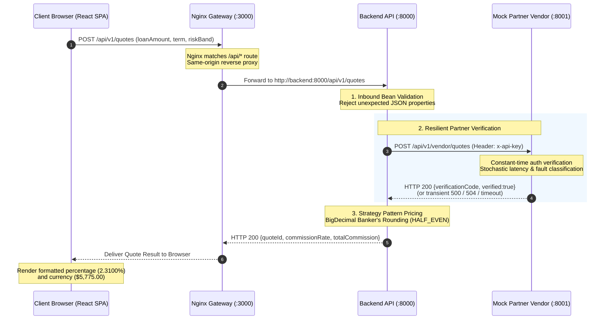
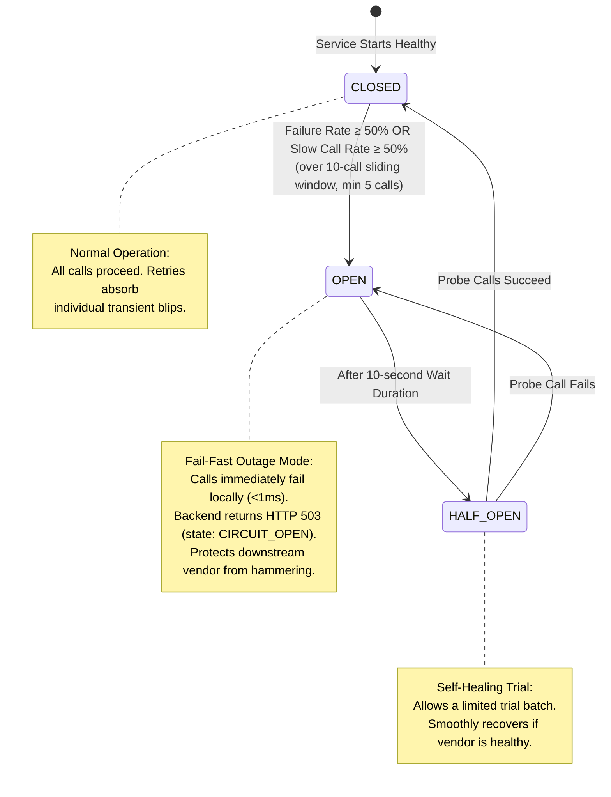

# System Architecture & Technical Design

This document describes the architectural philosophy, system boundaries, resilience models, and financial precision policies of the **Commission Quote Application**. It is intended as a clear, comprehensive guide for engineers evaluating or extending the codebase.

---

## 1. Architectural Philosophy & Core Invariants

The system is designed around five core engineering principles:

1. **Separation of Concerns & Swappable Seams**:
   The business domain (loan commission mathematics) is completely decoupled from infrastructure (REST controllers, Resilience4j decorators, and HTTP clients). All cross-boundary dependencies rely on pure Java interfaces wired in single `@Configuration` classes, making any component straightforward to swap, mock, or replace.
2. **Same-Origin Ingress (Zero CORS Overhead)**:
   The user interface and backend API are served through a unified Nginx gateway on port 3000. By reverse-proxying `/api/*` requests across the internal Docker network to the backend, the browser sees a single origin. This completely eliminates cross-origin browser preflight requests (`OPTIONS`), reduces network latency, and prevents client-side CORS configuration errors.
3. **Fail-Closed Resilience**:
   Downstream dependencies are assumed to be unreliable. Every network call is bounded by strict physical socket timeouts and per-attempt time limits. Transient blips are absorbed by automatic retries, while sustained partner degradation triggers a circuit breaker that fails fast locally to protect both our service and the partner.
4. **Strict Financial Precision**:
   Binary floating-point types (`double`, `float`) are strictly forbidden in all financial calculation and storage code paths. All calculations use `java.math.BigDecimal` paired with **Banker's Rounding** (`HALF_EVEN`) to eliminate systematic upward bias and preserve balance conservation.
5. **Least-Privilege Security**:
   Every container in the stack executes as a dedicated, unprivileged non-root user (`appuser`, UID 10001). Request payloads are strictly validated, unknown JSON properties are rejected to prevent parameter tampering, and credentials use constant-time equality checks to eliminate timing attack vectors.

---

## 2. End-to-End Orchestration Sequence

The following sequence diagram illustrates how a quote request travels through the system:

### Sequence Walkthrough
1. **User Action**: The applicant submits the form. The UI validates input boundaries via Zod and locks form controls to prevent duplicate submissions.
2. **Reverse Proxying**: Nginx receives the request on port 3000 and forwards it over the private Docker network to `http://backend:8000`.
3. **Inbound Validation**: The backend checks numerical bounds ($1,000–$10,000,000; 6–360 months; LOW/MEDIUM/HIGH). If any unknown or unexpected field is present, Jackson immediately rejects the request with HTTP 400 Bad Request.
4. **Partner Verification**: The backend issues a verification call to the mock vendor API. If the call times out or returns a transient error, Resilience4j automatically retries. If the partner service is down, the circuit breaker opens and fails fast with HTTP 503.
5. **Commission Calculation**: Once verified, the calculation strategy evaluates tenure in years, looks up the risk matrix, quantizes the rate to 4 decimal places, and evaluates total commission rounded to 2 decimal places (cents).
6. **Delivery**: The backend returns the quote DTO, which Nginx streams back to the browser for formatted rendering.

---

## 3. Structural Decomposition & Layered Architecture

The application cleanly separates responsibilities across three independent services:

### A. Frontend Web Interface (`frontend/`)
* **Technology**: React 18, TypeScript, Vite 5, Tailwind CSS, Nginx 1.27 Alpine.
* **Responsibilities**:
  * Client-side validation mirroring server rules via Zod schemas.
  * Form submission idempotency (inputs disable and display loading spinner during active network calls).
  * Degraded-state notification banners with a 2-second monotonic debounce timer on the retry button.
  * Same-origin Nginx reverse proxy routing `/api/*` traffic to the backend.
  * Browser security header injection (CSP, X-Frame-Options, HSTS, nosniff).

### B. Backend Calculation Engine (`backend/`)
* **Technology**: Java 25 LTS, Spring Boot 4.1.2, Resilience4j 2.4.0, Apache Tomcat, Maven.
* **Architecture**: Structured using Clean/Layered Architecture:
  * `api`: REST controllers, DTO records (`QuoteRequest`, `QuoteResponse`), and centralized exception translation (`ApiExceptionHandler`).
  * `domain`: Core financial logic, the pricing matrix model (`RiskBandMatrix`), the strategy interface (`CommissionCalculationStrategy`), and Banker's Rounding policies (`MoneyPolicy`).
  * `resilience`: Outbound partner port (`VendorQuotePort`) and the Resilience4j adapter (`VendorApiClientAdapter`).
  * `config`: Spring `@Configuration` classes wiring interfaces together and externalizing properties.

### C. Mock Partner Vendor Service (`mock-vendor/`)
* **Technology**: Java 25 LTS, Spring Boot 4.1.2, Apache Tomcat, Maven.
* **Responsibilities**:
  * Pure mathematical fault outcome classification (`classify(double)`).
  * Stochastic outcome partitioning: 80% HTTP 200 OK, 10% HTTP 500 Internal Error, 5% HTTP 400 Bad Request, and 5% HTTP 504 Gateway Timeout.
  * Configurable network latency injection (simulating real-world propagation delays).
  * Constant-time API key verification using `MessageDigest.isEqual`.

---

## 4. Resilience & Fault Tolerance State Machine

The backend utilizes **Resilience4j** to manage downstream vendor instability. The circuit breaker operates according to the following state lifecycle:

### Decorator Aspect Composition
The order in which Resilience4j decorators wrap the partner HTTP call is critical:

$$\text{Client Request} \longrightarrow \mathbf{\text{CircuitBreaker}} \Big[ \mathbf{\text{Retry}} \big[ \mathbf{\text{TimeLimiter}} \longrightarrow \text{HTTP Socket} \big] \Big]$$

* **TimeLimiter (Innermost)**: Bounds each individual HTTP attempt to **2,000 milliseconds**.
* **Physical Socket Timeouts**: Configured on the underlying `RestClient` (1s connect, 2s read) to guarantee sockets are terminated if an asynchronous future times out.
* **Retry (Middle)**: Executes up to **3 attempts** with exponential backoff (100ms, then 200ms) plus jitter. It catches only transient faults (`IOException`, HTTP 500, HTTP 504).
* **CircuitBreaker (Outermost)**: Wraps the entire retry chain. This design ensures that a single client request that requires 2 retries to succeed is counted as **1 successful logical call**, rather than registering false failures.
* **Non-Transient Fault Isolation (`ignore-exceptions`)**: Client errors (HTTP 400) and authentication failures (HTTP 401) are placed in `ignore-exceptions`. This ensures bad client data or credential typos never trip the circuit breaker and take down the service for other users.

---

## 5. Standardized Error Contracts

All endpoints return predictable, structured error envelopes matching RFC 7807 Problem Details principles:

| Scenario | HTTP Status | Contract Response Body | Explanation |
|---|:---:|---|---|
| **Validation Failure** | `400 Bad Request` | `{"detail": "Loan amount must be between $1,000 and $10,000,000."}` | Parameter out of bounds or missing required field. |
| **Parameter Tampering** | `400 Bad Request` | `{"detail": "Malformed or invalid request body."}` | Unexpected or unknown JSON attributes present in payload. |
| **Partner Outage (Retries Exhausted)** | `502 Bad Gateway` | `{"detail": "Vendor verification unavailable. Please retry."}` | Upstream partner failed after all 3 retry attempts were exhausted. |
| **Circuit Breaker Open** | `503 Service Unavailable` | `{"detail": "The third-party quote service is currently experiencing high error rates...", "state": "CIRCUIT_OPEN"}` | Circuit breaker is in OPEN state; requests fail fast locally to allow partner recovery. |

---

## 6. Financial Precision & Banker's Rounding

In financial systems, binary floating-point arithmetic (`double`, `float`) is unacceptable because numbers like `0.1` and `0.2` cannot be represented exactly in binary, leading to accumulated penny drift (e.g. `0.1 + 0.2 = 0.30000000000000004`).

### Precision Architecture
* **Strict BigDecimal Usage**: All monetary calculations and rates are evaluated strictly using `java.math.BigDecimal`.
* **Intermediate Division Scale**: When converting loan tenure from months to years (`termMonths / 12`), division can produce non-terminating expansions (e.g. $7 / 12 = 0.58333...$). The system evaluates tenure with an explicit intermediate scale of **10 decimal places** before rate calculation.
* **Banker's Rounding (`HALF_EVEN`)**: Standard rounding (`HALF_UP`) always rounds `.5` upwards towards positive infinity, introducing a systematic inflationary bias over thousands of portfolio calculations. Banker's Rounding rounds exact ties towards the nearest even number:
  * `0.01505` rounded to 4dp becomes **`0.0150`** (preceding digit 0 is even &rarr; rounds down).
  * `0.03515` rounded to 4dp becomes **`0.0352`** (preceding digit 1 is odd &rarr; rounds up).
  * Over large volumes of loan quotes, rounding errors cancel each other out symmetrically, preserving exact financial conservation.

---

## 7. Swappable Seams & Extensibility

Every major infrastructure boundary is abstracted behind an interface. Any implementation can be swapped cleanly without touching domain or presentation code:

| Architectural Seam | Active Default Implementation | Example Production Alternative |
|---|---|---|
| **Commission Pricing** | `MatrixCommissionStrategy` | Flat-rate strategy, dynamic tiered database calculator, or rules engine |
| **Partner Quote Verification** | `VendorApiClientAdapter` | gRPC client, reactive WebClient, or mock test stub |
| **Rounding Policy** | `MoneyPolicy` | Alternative institutional rounding models |
| **Fault Simulation Engine** | `FaultEngine` | Scripted chaos profiles, WireMock, or live partner sandbox |
| **UI Network Layer** | `quote.ts` (same-origin fetch) | Direct base-URL client, React Query, or Axios interceptors |

---

## 8. Contract-First Schema Synchronization (ADR-007)

To ensure that the frontend and backend never drift out of alignment, the repository establishes `.github/specs/openapi.yaml` as the **Single Source of Truth**:

1. **Frontend Synchronization**: Running `npm run codegen` uses `openapi-typescript` to compile the OpenAPI contract into strict TypeScript types (`src/api/generated.ts`). A bidirectional compile-time type assertion ensures that if the OpenAPI schema changes, the TypeScript build fails immediately until the Zod runtime schema is updated.
2. **Backend Synchronization**: During every Maven build, `OpenApiContractDriftTest` dynamically parses `openapi.yaml` and reflects over the Java DTO records (`QuoteRequest` and `QuoteResponse`). It verifies that property names, required fields, numerical bounds, and enum tiers match the specification byte-for-byte.

---

## 9. Regulated Banking Production Roadmap (ADR-008)

For complete technical specifications on elevating this local containerized MVP to an enterprise regulated banking deployment under Australian APRA CPS 234 and PCI-DSS compliance, see **[ADR-008](docs/adr/ADR-008-production-banking-readiness.md)**:
* **Mutual TLS (mTLS 1.3)**: Zero-trust encrypted inter-service transport via Service Mesh (Istio) or Spring Boot SSL bundles.
* **Network Segmentation**: Public Application Load Balancer terminates TLS; backend and vendor microservices reside in private VPC subnets with zero public ingress.
* **Centralized Secrets**: AWS Secrets Manager or HashiCorp Vault with KMS Customer-Managed Key envelope encryption and automated 30-day rotation.
* **Edge WAF & Anti-Abuse**: Cloudflare or AWS WAF rate-limiting, bot control, and OWASP Core Rule Set inspection.
* **Audit Logging & SIEM**: Immutable WORM audit logs with OpenTelemetry correlation IDs (`traceId`, `spanId`) streamed to Splunk or Datadog.
* **Supply Chain Security**: Cosign container signing, CycloneDX SBOM generation, and automated Trivy CVE scanning in CI/CD.

---

## 10. Architectural Decision Records (ADRs)

The repository records all foundational design choices in standardized ADR format under [`docs/adr/`](docs/adr/):
* **[ADR-001](docs/adr/ADR-001-platform-choice.md)**: Selection of Java 25 LTS and Spring Boot 4.1.2 for modern language features, virtual threads, and enterprise support.
* **[ADR-002](docs/adr/ADR-002-resilience4j.md)**: Resilience4j aspect composition for inter-service fault tolerance.
* **[ADR-003](docs/adr/ADR-003-externalized-config.md)**: Externalization of business rules, pricing matrices, and fault rates into 12-factor configuration.
* **[ADR-004](docs/adr/ADR-004-docker-compose.md)**: Multi-container local orchestration via Docker Compose.
* **[ADR-005](docs/adr/ADR-005-spec-deviations.md)**: Formal reconciliation of business rules and architecture standards.
* **[ADR-006](docs/adr/ADR-006-loan-bounds-constants.md)**: Governance of loan policy bounds as single-source-of-truth compile-time constants.
* **[ADR-007](docs/adr/ADR-007-contract-first-schema-sync.md)**: Contract-first OpenAPI schema synchronization and bidirectional drift verification.
* **[ADR-008](docs/adr/ADR-008-production-banking-readiness.md)**: Regulated banking production readiness roadmap (APRA CPS 234 / PCI-DSS).
