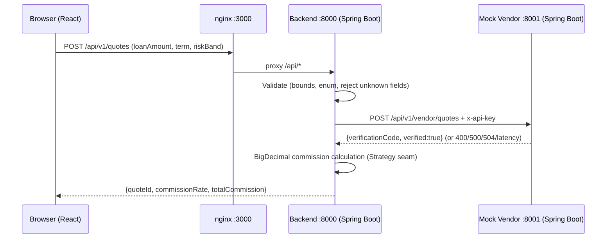
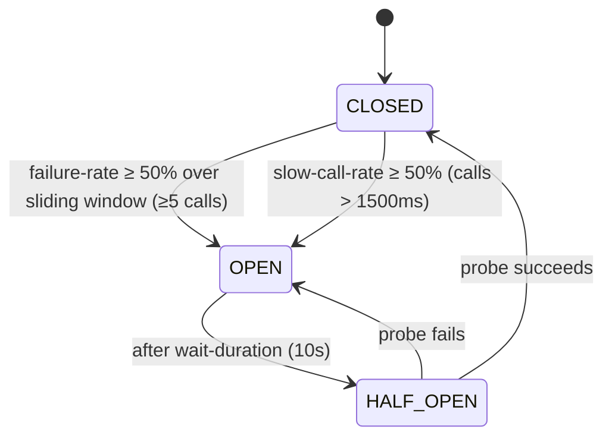

# Architecture

## System overview

## Components

- **frontend/** — React 18 + Vite + TypeScript + Tailwind. Zod schema mirrors the
  backend validation. nginx serves the SPA and reverse-proxies `/api/*` —
  same-origin by design, no CORS, no build-time API URL.
- **backend/** — Spring Boot. Layered: `api` (Controller, DTOs, exception
  handler) → `domain` (Strategy, matrix, MoneyPolicy) → `resilience`
  (VendorQuotePort + Resilience4j adapter). All seams are interfaces wired in a
  single `@Configuration` class.
- **mock-vendor/** — Spring Boot. Pure `FaultEngine` classifier + controller
  with per-request environment reads.

## Resilience state machine (Resilience4j)

Request-level protection:

| Layer | Config |
|---|---|
| TimeLimiter | 2000ms per attempt |
| Socket Timeouts | Physical 1000ms connect, 2000ms read timeout on `RestClient` |
| Retry | 3 attempts, 500ms exponential backoff + jitter, only 500/504/IOException |
| CircuitBreaker | 10-call sliding window, min 5 calls, 50% failure / 50% slow threshold, 10s open wait (`ignore-exceptions` on 400/401) |

Aspect order (innermost → outermost): TimeLimiter → Retry → CircuitBreaker.
The CircuitBreaker is OUTSIDE the Retry: one logical request records exactly one
CB call regardless of internal retries; the fallback is narrowed to
`CallNotPermittedException` so exhausted retries still surface as 502.
Non-transient errors (HTTP 400 and 401) are in `ignore-exceptions` so they do not
trip the circuit breaker into false outages.

## Error contract

| Condition | HTTP | Body |
|---|---|---|
| Validation failure | 400 | `{"detail": "<exact message>"}` |
| Vendor failure (retries exhausted, 400/401) | 502 | `{"detail": "Vendor verification unavailable. Please retry."}` |
| Circuit OPEN | 503 | `{"detail": "<banner>", "state": "CIRCUIT_OPEN"}` |

## Financial precision

BigDecimal everywhere; divide at 10dp intermediate scale; rate quantized 4dp
HALF_EVEN before multiplication; money 2dp HALF_EVEN. No `double`/`float` in
money code paths. See `.github/specs/spec.md` Rule 4 for the worked example and
the FR-3 example discrepancy.

## Swappable seams

| Seam | Default | Swap variant accommodated |
|---|---|---|
| `CommissionCalculationStrategy` | MatrixCommissionStrategy | flat-rate / remote pricing |
| `VendorQuotePort` | VendorApiClientAdapter (RestClient + Resilience4j) | WebClient / gRPC / stub |
| `MoneyPolicy` | HALF_EVEN 4dp/2dp | other rounding modes |
| `FaultEngine` | seeded RandomGenerator | scripted chaos profiles |
| frontend `quote.ts` | same-origin fetch | direct URL / react-query |

Every judgment call in the code carries `// ATTENTION(kind): ...`; grep
`ATTENTION(` for the full index.

## Architecture Decision Records (ADRs)

- **[ADR-001](docs/adr/ADR-001-platform-choice.md):** Java 25 LTS & Spring Boot 4.1.2 Platform Choice
- **[ADR-002](docs/adr/ADR-002-resilience4j.md):** Resilience4j for Inter-Service Fault Tolerance
- **[ADR-003](docs/adr/ADR-003-externalized-config.md):** Externalized Configuration
- **[ADR-004](docs/adr/ADR-004-docker-compose.md):** Multi-Container Orchestration via Docker Compose
- **[ADR-005](docs/adr/ADR-005-spec-deviations.md):** Spec Deviations & Merged Business Rules
- **[ADR-006](docs/adr/ADR-006-loan-bounds-constants.md):** Loan Policy Bounds Are Compile-Time Constants
- **[ADR-007](docs/adr/ADR-007-contract-first-schema-sync.md):** Contract-First API Specification & Schema Evolution
